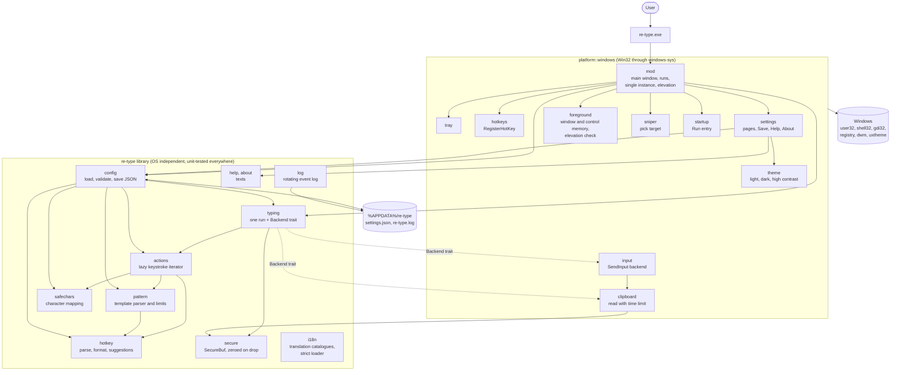
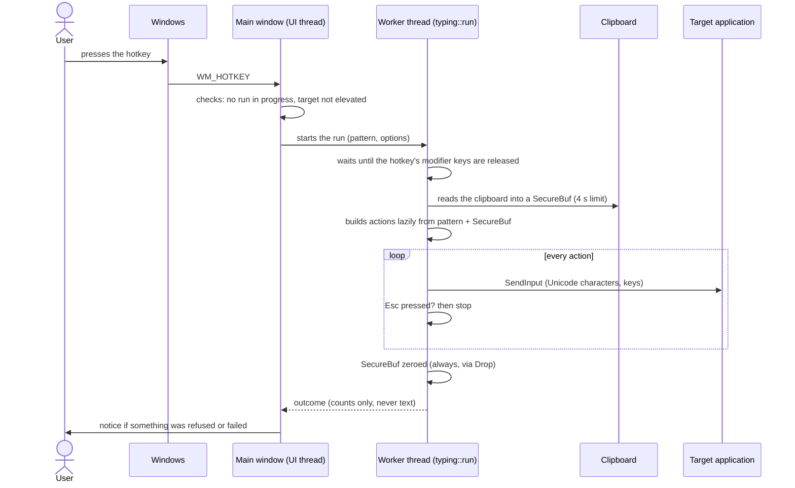
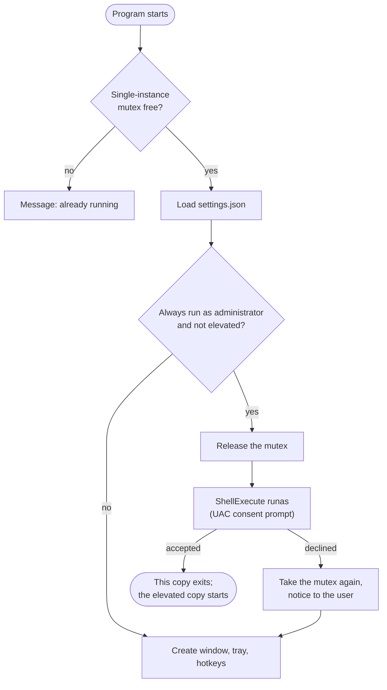

# Re:Type – Design

Public document. The requirements are in [requirements.md](requirements.md); how to use the program is in [user-guide.md](user-guide.md).

## Overview

One Rust package, `re-type`, with a platform-independent library and a thin Windows layer. One executable, `re-type`, is built from it. A Linux layer can be added later behind the same `typing::Backend` interface.

The program is a single-process tray application. It owns a message-only window that receives hotkeys and tray messages, a settings window built from standard Windows controls, and one worker thread per typing run. It opens no network connections and keeps no copy of the typed text.

## Architecture

## A typing run

## Start-up and administrator rights

There is deliberately no silent elevated start (no scheduled task with highest privileges): every elevated start needs the user's consent.

## Design choices

| ID | Choice | Reason |
|---|---|---|
| DC-001 | Library crate holds all logic that does not call Windows (config, hotkey parsing, patterns, action building, secure buffer, logging). It is unit-tested on any OS. | Testable without Windows; reusable for Linux. |
| DC-002 | The shared typing run (`typing::run`) talks to the operating system only through the `typing::Backend` trait: read the clipboard into a `SecureBuf`, send characters and key combinations, tell which modifier keys are held, say whether Esc was pressed. `platform::windows` implements it; hotkeys, tray and settings window are Windows code that call the shared library. | Keeps Windows code isolated; a Linux backend can be added without touching the shared logic. |
| DC-003 | Keystrokes are sent with `SendInput`: Unicode events (`KEYEVENTF_UNICODE`, UTF-16 units) for characters, virtual-key events for keys and combinations. | Layout-independent; emoji work as surrogate pairs. |
| DC-004 | Before typing, wait until the hotkey's modifiers are physically released (configurable timeout, then force-release). If Alt or Win was part of the hotkey, send a neutral key first so the release does not open a menu. | Held modifiers would turn typed characters into shortcuts. |
| DC-005 | Hotkeys use `RegisterHotKey` on the thread that owns the message window. A candidate hotkey is probed by registering and immediately unregistering it. Error 1409 is reported as "already registered". The limit (shortcuts handled inside other applications cannot be seen) is shown to the user in the settings window. | Documented Windows mechanism; no keyboard hook, no key logging. |
| DC-006 | `SecureBuf` owns the typing buffer (UTF-16, fixed capacity from the configured limit, never reallocated). It is filled directly from the clipboard memory, read in place by the action builder, and zeroed with volatile writes in `Drop`, so a completed, aborted, failed or panicking run all clear it. No `String` copy of the clipboard is made. | REQ-SEC-003; Rust lets the application control every copy it makes. |
| DC-007 | Actions are produced lazily from the pattern and the `SecureBuf` (an iterator), not collected into a list. | A list of actions would be another copy of the text. |
| DC-008 | Template patterns use brace tokens: `{CLIPBOARD}`, a small set of keys (`{TAB}`, `{SHIFT+TAB}`, `{ENTER}`, arrows, `{HOME}`, `{END}`, `{BACKSPACE}`, `{DEL}`), repeats (`{TAB 3}`, at most 5), `{DELAY ms}` (at most 1000), and `{{` `}}` for literal braces. Everything else is typed as written. The parser knows more keys than a template may use; `pattern::check_template` is the rule that keeps templates to text entry and navigation (see DC-025). BASIC uses the fixed pattern `{CLIPBOARD}`. | Simple and readable, and Re:Type stays a text-entry aid instead of a general automation tool. |
| DC-009 | Configuration is JSON (`serde`, `serde_json`) at `%APPDATA%\re-type\settings.json`, written atomically (temp file, then rename). Unknown or invalid values fall back to defaults with a logged warning. An unparsable file is renamed to `settings.json.bad`. Limits are clamped. | REQ-DATA-001; fail gracefully. |
| DC-010 | The log is a small plain-text file `re-type.log` next to the configuration, rotated to `re-type.log.1` at 256 KiB. It records events, errors and lengths, never clipboard text. | REQ-PROC-001, REQ-SEC-001. |
| DC-011 | The Windows UI is native Win32 through `windows-sys`: a message-only window for hotkeys, `Shell_NotifyIconW` for the tray, and a settings window built from standard controls. No GUI framework. | Few dependencies, small signed executable (REQ-PROC-002). |
| DC-012 | Typing runs on a worker thread, one run at a time; hotkeys pressed during a run are ignored. Esc is polled between keystrokes. A run longer than the configured limit is refused before any key is sent. | Keeps the UI responsive; REQ-SAFE-001. |
| DC-013 | A named mutex ensures a single instance. The executable manifest asks for no elevation (`asInvoker`). The program asks for administrator rights only when the user switched on "Always run as administrator" (DC-026). | REQ-UX-003, REQ-SEC-002. |
| DC-014 | The application opens no sockets and links no networking crate. | REQ-SEC-001. |
| DC-015 | There is a single edition with every feature (templates included). An earlier plan for a reduced edition was dropped. | REQ-PROC-003, REQ-LIC-001. |
| DC-016 | Signing happens outside the program, with `signtool` and an RFC 3161 timestamp, on the released executable. No certificate, key or password is stored in the repository. | REQ-SEC-004. |
| DC-017 | Safe characters are a pure function (`safechars::map`) applied lazily to the clipboard segment only, using small static tables; replacements are ASCII strings typed unit by unit, so no extra copy of the clipboard is made. | REQ-FUNC-007, REQ-SEC-003. |
| DC-018 | The clipboard is read on a worker thread with a 4 s time limit; format order is text, then file list, then known image formats, then anything else (refused with a notice). | REQ-FUNC-008, ASM-012, ASM-013. |
| DC-019 | The settings window has one child page window per option group; labels are measured and wrapped for the current DPI and width, the window has a minimum size computed from the content, and the font follows the DPI. The application manifest enables the visual styles (comctl32 v6). | REQ-UX-005. |
| DC-020 | The clipboard sequence number is stored when the clipboard is read. After a completed run that used the clipboard, the clipboard is emptied only if the number is unchanged, checked again while the clipboard is held, so newer content is never destroyed. Controlled by `typing.clear_clipboard` (default true). | REQ-SEC-005, ASM-014. |
| DC-021 | The tray command follows the foreground window and the focused control with two WinEvent hooks (own process and shell windows ignored), stores only their handles, and before typing brings the window to the front, checks that it is in front, and puts the keyboard focus back on the remembered control if it still exists and belongs to that window. If not, it types nothing and shows a notice. Typing uses the clipboard pattern alone, no modifiers to wait for. | REQ-UX-006, ASM-015. |
| DC-022 | Colour scheme (REQ-UX-007): `theme.rs` holds two palettes, the system colours (light and high contrast) and a fixed dark one. Dark uses the Windows dark control themes, a dark title bar, and the tab strip and check boxes painted by the application (subclassing; the controls keep their roles). Tray menus follow `SetPreferredAppMode`. Everything undocumented is looked up at run time and optional (ASM-016). Setting `appearance.theme` = system, light or dark. |
| DC-024 | Pick target (REQ-UX-008): `sniper.rs` installs a `WH_MOUSE_LL` hook that only reads mouse messages, swallows the left and right button and posts move, pick and cancel to the main window; a click-through layered frame window outlines the control under the pointer; Esc is a temporary hotkey, a 30 s timer ends the mode, everything is removed on every exit. The target (window and control handles, picked point) is passed to the typing thread for that run only. `foreground::bring_to_front` takes the control and a strict flag; `click_at` is the fallback. Window classes known to draw their own fields go straight to the click. |
| DC-023 | Accessibility (REQ-ACC-001..005): standard controls only; a label created right before its field names it; labels, buttons and check boxes carry access keys; notes and status lines are read-only edit controls so that they can be focused and read; the window is a normal top-level window with `IsDialogMessage` navigation plus Ctrl+Tab for pages; status changes raise name, value and live-region events; the tray icon uses version 4 messages so that the menu key, Shift+F10 and Enter work; a manifest enables visual styles (comctl32 6) and per-monitor DPI. |

**DC-025 Template limits.** `pattern::check_template` is the single rule for what a template may contain (required `{CLIPBOARD}`, allowed keys list, repeat ≤ 5, delay ≤ 1000 ms). It runs in `Config::validate` (save) and in `Config::from_value` (load: breaking templates are set to disabled with a warning, pattern kept). The typing engine is unchanged.

**DC-026 Startup and elevation.** `platform/windows/startup.rs` writes, repairs and removes the per-user Run value and reads the Task Manager switch (`StartupApproved\Run`). `config.startup.at_logon` and `config.startup.elevated` are the settings. At start, before anything else is created, `run()` checks the elevated option: if it is on and the process is not elevated (token elevation, shared helper in `foreground.rs`), it releases the single-instance mutex, starts a copy with `ShellExecuteW("runas")` and exits; if Windows refuses (UAC declined) it takes the mutex again, keeps running and shows a notice. A silent elevated autostart through a highest-privilege scheduled task was rejected: it would run a user-writable program with administrator rights without consent.

**DC-027 Help.** `src/help.rs` builds the help text (CRLF line breaks, plain text) and is unit-tested for coverage of every settings page and for the warnings. The settings window shows it on a last page "Help" in a read-only multi-line edit control; F1 and the tray command open that page.

**DC-028 Pick target switch and shortcut.** `Config.pick_enabled` (default true) and `Config.pick_hotkey` (default empty). `bindings()` adds a binding with the reserved id `PICK_ID` only when the mode is on and a shortcut is set; `WM_HOTKEY` for that id calls `pick_begin`, which also refuses to start when the mode is off. The tray menu omits the command when the mode is off. The settings controls sit on the Hotkeys page.

**DC-029 Two-pane settings window.** The sections (Hotkeys, Typing, Clipboard, Appearance, Startup, Templates, Help, About) are listed in a list box on the left; the page of the selected section is shown on the right. There are no tabs. Ctrl+Tab, Ctrl+PgUp and Ctrl+PgDn move through the sections from anywhere in the window, F1 selects Help. A button named `settings.json` in the footer opens the folder of the settings file in Explorer with the file selected; the footer text next to it shows results (saved, hotkey checks).

**DC-030 Translations.** `src/i18n.rs` keeps one active catalogue: a map from the English text to its translation. The interface calls `tr("English text")` or `trf("... {0}", &[arg])`; a text without a translation is shown in English. The six languages are English plus built-in catalogues for Italian, French, German, Spanish and Portuguese (`lang/*.json`, embedded in the executable), and users can add a file `xx.json` or `xx-yy.json` in the `lang` folder next to `settings.json`; a user file wins over a built-in one with the same code. The language is chosen on the Appearance page (`appearance.language` in `settings.json`: `auto` follows the Windows display language). A catalogue is data only and is validated strictly before use (REQ-I18N-002): file size, number and length of entries are limited; values must be JSON strings; control characters, invisible characters and text-direction overrides are refused; the `{...}` tokens of a translation must be exactly those of the English text, otherwise that entry is ignored. A translation is never used as a format string, path, command or address, and the only substitution is of `{0}`, `{1}`... by program-made values. A damaged file is ignored as a whole. Tests: `i18n` unit tests (loader, hostile files, user-file precedence) and `tests/i18n_catalogs.rs` (every text of the sources is translated in every built-in language, and nothing else is). Help and About are English only for now. The settings window is not mirrored for right-to-left languages (not supported yet); typing right-to-left text is not affected because the program types the characters in the order of the clipboard (see the user guide).

## Dependencies

`serde_json` (and its dependencies) and `windows-sys` (Windows only). Nothing else. The licences are listed in [THIRD-PARTY-NOTICES.md](../THIRD-PARTY-NOTICES.md).

## Files

| Path | Purpose |
|---|---|
| `re-type/Cargo.toml`, `Cargo.lock` | package and the `re-type` binary |
| `re-type/build.rs` | links the icon and manifest resources |
| `re-type/src/lib.rs` | module list, product name |
| `re-type/src/secure.rs` | `SecureBuf` |
| `re-type/src/hotkey.rs` | key names, hotkey parsing and formatting, free-hotkey suggestions |
| `re-type/src/pattern.rs` | template pattern parser and template limits |
| `re-type/src/actions.rs` | action iterator from pattern, buffer and typing options |
| `re-type/src/safechars.rs` | safe-character mapping |
| `re-type/src/typing.rs` | one typing run and the `Backend` trait |
| `re-type/src/config.rs` | configuration model, loading, validation, saving |
| `re-type/src/log.rs` | rotating log |
| `re-type/src/help.rs`, `about.rs` | texts of the Help and About pages |
| `re-type/src/i18n.rs`, `re-type/lang/*.json` | translation loader and the built-in catalogues |
| `re-type/src/platform/windows/` | clipboard, input, hotkeys, tray, settings window, theme, start-up, pick target, foreground handling |
| `re-type/src/bin/` | entry point |
| `re-type/tests/` | integration tests (licence lines, translation catalogues, control ids) |
| `re-type/assets/` | icon, precompiled icon resource, resource script, manifest |
